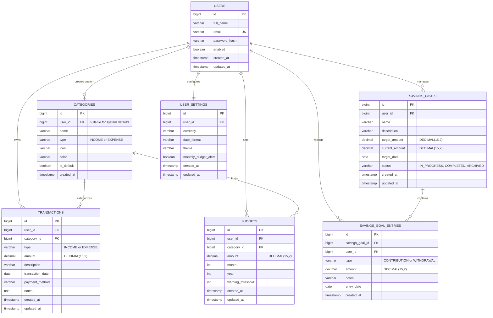
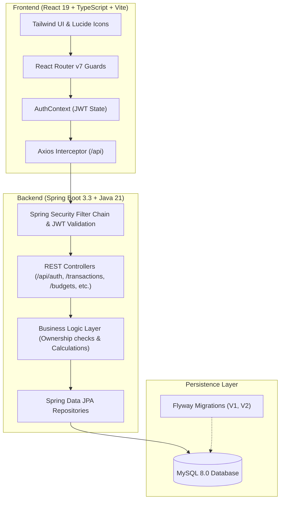

# SpendWise — Personal Expense Tracker

[](https://adoptium.net/)
[](https://spring.io/projects/spring-boot)
[](https://react.dev/)
[](https://www.typescriptlang.org/)
[](https://tailwindcss.com/)
[](https://www.mysql.com/)

A modern, full-stack personal finance SaaS application engineered for precision, privacy, and actionable financial clarity. SpendWise allows individuals to track earnings and expenses, configure monthly category budgets with warning limits, track milestones via savings goals, and generate monthly reports.

Designed as an enterprise-grade technical training project showcasing clean architecture, secure authorization scoping, relational data integrity, and a design system inspired by commercial financial products.

---

## 1. Project Objective & Problem Statement

### Problem Statement
Most individuals struggle to maintain financial discipline due to fragmented financial records across payment apps (UPI, credit cards, bank accounts), opaque spending patterns, lack of proactive budget alerts, and confusing savings calculations that double-count transfers. Basic spreadsheet tracking suffers from formula errors, lacks real-time warnings, and offers no user-isolated workspace security.

### Project Objective
SpendWise provides a centralized, secure financial control center where users can:
- Record and categorize income and expenses with payment mode tracking (UPI, Credit/Debit Card, Bank Transfer, Cash).
- Enforce strict private workspaces where one user can never inspect, modify, or leak another user's financial records.
- Set category-specific monthly budgets with visual warnings at 75%, 85%, or 90% utilization.
- Track dedicated savings goals with independent contribution and withdrawal logs.
- Visualize cash flow, category breakdowns, and spending velocity via interactive Recharts.
- Export sanitized CSV financial reports (protected against CSV formula injection).

---

## 2. Technology Stack

### Backend
- **Language**: Java 21 LTS (OpenJDK Temurin)
- **Framework**: Spring Boot 3.3.4
- **Security**: Spring Security 6 with JWT (JJWT 0.12.6) & BCrypt password hashing
- **Data Access**: Spring Data JPA (Hibernate 6)
- **Database Migrations**: Flyway 10
- **Validation**: Jakarta Validation (`hibernate-validator`)
- **Exporting**: Apache Commons CSV
- **Testing**: JUnit 5, Mockito, Spring Security Test
- **Monitoring**: Spring Boot Actuator

### Frontend
- **Framework**: React 19 with TypeScript
- **Tooling**: Vite 8 & PostCSS
- **Styling**: Tailwind CSS 3.4 with custom design tokens (Navy, Emerald, Rose, Amber, Indigo)
- **Routing**: React Router v7
- **Forms & Validation**: React Hook Form with Zod schemas
- **Icons**: Lucide React
- **Data Visualization**: Recharts
- **HTTP Client**: Axios with request/response interceptors
- **Notifications**: React Hot Toast

### Database & Infrastructure
- **RDBMS**: MySQL 8.0 (InnoDB engine, utf8mb4 charset)
- **Local MySQL Port**: `3307` (configurable, user-isolated)
- **Containerization**: Docker Compose (`docker-compose.yml`)

---

## 3. Database Design & Mermaid ER Diagram

The database schema is normalized and version-controlled via Flyway migrations (`V1__init_schema.sql` and `V2__seed_system_categories.sql`).



---

## 4. Application Architecture



---

## 5. Security & Ownership Architecture

1. **User-Isolated Workspaces**:
   Every database query and mutation is strictly filtered by the authenticated user's ID (`@AuthenticationPrincipal UserPrincipal`). A user cannot view, edit, or delete another user's transaction, category, budget, or savings goal.
2. **Password Hashing**:
   Passwords are never stored in plaintext or logged. All passwords are encrypted with `BCryptPasswordEncoder`.
3. **Stateless JWT Authentication**:
   Authentication tokens are signed using HMAC-SHA256 with expiration timestamps and validated on every API request.
4. **Input Validation**:
   Backend input validation uses `@Valid` with Jakarta annotations (`@DecimalMin`, `@Digits`, `@Size`, `@Email`). Frontend input uses Zod schemas with React Hook Form.
5. **CSV Formula Injection Defense**:
   Exported CSV cell values beginning with `=`, `+`, `-`, or `@` are sanitized with a leading quote to neutralize spreadsheet formula injection vulnerabilities.

---

## 6. Financial Calculations Model

- **Period Income Total**: `∑ amount` for all `INCOME` transactions within `startDate` and `endDate`.
- **Period Expense Total**: `∑ amount` for all `EXPENSE` transactions within `startDate` and `endDate`.
- **Period Net Cash Flow**: `Period Income Total - Period Expense Total`.
- **Available Balance**: Cumulative all-time income minus all-time expense.
- **Budget Actual Spending**: `∑ amount` for expenses matching the budget category, month, and year.
- **Budget Remaining**: `budget.amount - actualSpending`.
- **Budget Utilization**: `(actualSpending / budget.amount) * 100`.
- **Warning Thresholds**:
  - `Normal` (< threshold %)
  - `Warning` (≥ threshold %, e.g., 80%)
  - `Exceeded` (≥ 100%)
- **Savings Progress**: `(currentAmount / targetAmount) * 100`. Automatically transitions to `COMPLETED` when target is reached.

---

## 7. Development Quickstart Guide

### Prerequisites
- Java 21 JDK installed
- Apache Maven 3.9+ installed
- Node.js 18+ and npm installed
- MySQL 8.0 server (local service or Docker)

### Step 1: Start MySQL Database
If using local MySQL:
Ensure MySQL is accessible on port `3307` (or change `DB_PORT` in `application.yml` to `3306`).
Database `spendwise` will be migrated automatically by Flyway on startup.

If using Docker:
```bash
docker compose up -d
```

### Step 2: Start the Java Spring Boot Backend
```bash
cd backend
mvn clean package -DskipTests
java -jar target/spendwise-backend-1.0.0.jar --server.port=8085
```
Backend runs on: `http://localhost:8085`
Health check: `http://localhost:8085/actuator/health`

### Step 3: Start the React Frontend
```bash
cd frontend
npm install
npm run dev
```
Frontend runs on: `http://localhost:5174` (or `http://localhost:5173`)

---

## 8. Development Seed Account

SpendWise automatically seeds a realistic development account on first startup:
- **Email**: `demo@spendwise.com`
- **Password**: `Demo@123`

The demo account is pre-populated with:
- Multi-month salary, freelance, and investment dividends.
- Diverse living expenses across rent, groceries, utilities, dining, subscriptions, and transport.
- Monthly budgets with visual utilization and warning thresholds.
- Savings goals (Emergency Fund, Japan Vacation, MacBook Pro) with contribution entry histories.

Click the **"Fill Demo"** button on the Login page for 1-click credential autofill!

---

## 9. Running Tests

### Backend Automated Tests
Execute the unit and integration test suite:
```bash
cd backend
mvn test
```
The test suite covers:
- User registration, duplicate email rejection, password confirmation checks (`AuthServiceTest`).
- Transaction creation, amount scaling, category type mismatch validation (`TransactionServiceTest`).
- Budget threshold calculations (80%, 100%), duplicate budget rejection (`BudgetServiceTest`).
- Savings goal contributions, withdrawal boundary checks, target completion (`SavingsGoalServiceTest`).

### Frontend Production Build
```bash
cd frontend
npm run build
```
Compiles TypeScript with Vite and produces a production bundle in `dist/`.

---

## 10. Technical Training Presentation Outline

This project is tailored for a technical full-stack presentation:

### Slide 1: Introduction & Architecture Overview
- Title: *SpendWise: Personal Finance Management Architecture*
- Highlights: Multi-tiered architecture, Java 21, Spring Boot 3.3, React 19, MySQL 8.
- Problem solved: Privacy, mathematical accuracy, multi-device responsiveness.

### Slide 2: Security & Multi-Tenancy Architecture
- Stateless JWT lifecycle with HMAC SHA-256 signatures.
- Service-layer authorization validation preventing horizontal privilege escalation (BOLA/IDOR).
- BCrypt password hashing and CORS origin isolation.

### Slide 3: Database & Migration Strategy
- Flyway migration pipeline (`V1__init_schema.sql`, `V2__seed_system_categories.sql`).
- Relational integrity: Foreign key constraints, compound unique constraints (`uq_budget_user_cat_month_year`).
- `DECIMAL(15,2)` representation to eliminate IEEE 754 floating-point inaccuracies.

### Slide 4: Real-time Analytics & Business Logic
- Period vs. Cumulative balance accounting models.
- Recharts visualizations: Cash flow bar charts, category doughnut charts, daily trend lines.
- Dynamic JPA Criteria Specifications for filtering by type, category, date, and payment mode.

### Slide 5: Live Demonstration Workflow
1. Sign in with the pre-populated demo account or register a new workspace.
2. Review Dashboard summary cards (INR `₹` formatting) and cash flow trends.
3. Record a new expense using the global Navbar button.
4. Demonstrate budget threshold color shifting (Green → Amber → Red).
5. Record a savings goal deposit and verify progress recalculation.
6. Export transaction records to CSV and print the monthly report.

---

## 11. Common Errors and Troubleshooting

| Symptom | Cause | Solution |
| :--- | :--- | :--- |
| `Port 8080/8085 is in use` | Another local service running on the port | Set `--server.port=8086` when launching jar or adjust `PORT` in `.env` |
| `Access denied for user 'root'@'localhost'` | MySQL root password mismatch | Ensure MySQL is running on port 3307 with empty password or update `DB_PASSWORD` in `application.yml` |
| `Vite port 5173 in use` | Another Vite development process running | Vite automatically switches to 5174; backend CORS already allows 5174 |
| `Cannot delete category` | Active transactions reference the category | Reassign or delete transactions before deleting a custom category |

---

## 12. Future Enhancements
- Automated bank statement PDF parsing with OCR/regex.
- Recurring transaction schedules (e.g. monthly subscriptions auto-logged on 1st of month).
- Multi-currency conversion via real-time exchange rate APIs.
- Dark mode toggle option in user settings.
